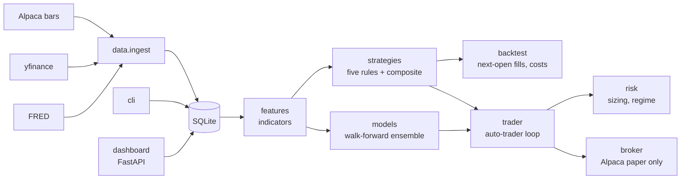

# trading-bot-ml

[](https://github.com/lUIZhMACEDO/trading-bot-ml/actions/workflows/ci.yml)

A paper-trading bot I built on Alpaca's API to see whether simple technical rules and a small ML
ensemble hold up once you charge realistic costs and stop the model from peeking at the future. It
scores a watchlist with five rule-based strategies, trains a walk-forward ensemble that predicts
the direction of the 21-day forward return, backtests with next-open fills, commission and
slippage, and places orders on an Alpaca paper account from a terminal shell or a small browser
dashboard. Everything is stored locally in SQLite.

It only trades on Alpaca's paper endpoint. There is no live-trading setting, and none of this is
investment advice.

## Quick start

You need Python 3.11 or newer.

```bash
git clone https://github.com/lUIZhMACEDO/trading-bot-ml.git
cd trading-bot-ml
python -m venv .venv
source .venv/bin/activate          # Windows: .venv\Scripts\activate
pip install -r requirements-dev.txt
pip install -e .
```

**1. Score the strategies on the sample CSV (offline, no API keys).** `examples/sample_prices.csv`
is 300 trading days of synthetic daily prices: a slow decline, a sharp rally, a flat stretch, a
pullback and a recovery.

```bash
python -m trading_bot analyze examples/sample_prices.csv
```

Expected output:

```
SAMPLE  composite +0.60  Neutral  (buy 1, sell 0, hold 4)
  rsi_macd      HOLD +0.00  RSI=75, MACD_hist=0.340
  bollinger     HOLD +0.00  Hurst=0.67, trending regime, skip reversion
  golden_cross  HOLD +0.00  SMA50=65, SMA200=77
  momentum      HOLD +0.00  Mom5=1.4%, Mom21=10.2%, ADX=59
  hurst         BUY  +0.60  Trending regime (H=0.67): EMA9 > EMA21, ride trend
```

Each strategy looks at the last bar and returns BUY, SELL or HOLD with a score from -1 to +1. The
composite is the sum of the five scores; it needs to reach +1.0 to count as a Buy, so one +0.60
signal stays Neutral.

**2. Backtest one strategy on the same file.**

```bash
python -m trading_bot backtest examples/sample_prices.csv --strategy momentum --trades
```

Expected output:

```
backtest momentum on SAMPLE  2025-09-30 to 2026-10-28
  total return  +10.99%
  sharpe        0.79
  max drawdown  11.66%
  win rate      100.0%
  fills         3
  avg trade     +2.08%
  costs         $202.09
  2026-01-02  BUY   1210 @ 78.51  cost $66.50
  2026-07-06  SELL  1210 @ 80.14  cost $67.88
  2026-09-22  BUY   1466 @ 65.98  cost $67.71
```

The backtest starts with $100,000 and skips the first 30 bars as warm-up. Every fill happens at
the next day's open and pays 5 bps commission plus 2 bps slippage, so the first buy costs
1210 x 78.51 x 0.0007 = $66.50. The last position is still open at the end and is valued at the
final close, which is where most of the +10.99% comes from. Swap in `rsi_macd`, `bollinger`,
`golden_cross` or `hurst` for the other strategies, or pass `--commission-bps 0 --slippage-bps 0`
to see how much the costs take. `tests/test_cli.py` checks both outputs above exactly, so they stay
accurate.

**3. Run the tests.**

```bash
pytest
```

All 115 tests should pass in under a minute without network access.

## Running it against Alpaca paper trading

Create paper keys at [app.alpaca.markets](https://app.alpaca.markets) (switch to Paper Trading,
then API Keys). Copy `.env.example` to `.env` and fill in `ALPACA_API_KEY` and
`ALPACA_SECRET_KEY`. If you skip this, the terminal shell asks for the keys on first run and writes
`.env` for you.

```bash
python -m trading_bot              # terminal shell, same as: python cli.py
trading-bot-dashboard              # browser dashboard on http://127.0.0.1:8000, same as: python dashboard.py
```

On the first run with an empty database the shell offers to run the full pipeline, which takes
about two minutes. Useful shell commands:

```
pipeline                 download 2 years of bars, fundamentals and FRED data, compute indicators
scan                     composite score for the whole watchlist
analyze AAPL             five-strategy breakdown for one ticker
train AAPL               walk-forward ML training, prints the fold accuracies
predict AAPL             ML ensemble signal for the latest bar
backtest AAPL momentum   backtest one strategy with costs
buy AAPL 10 [price]      paper market order, or a limit order if you give a price
positions                current holdings
auto start composite     start the auto-trader (composite, ml, or one strategy name)
regime                   bull / bear / sideways / high_vol read from SPY, VIX and breadth
help                     the full list
```

The dashboard has tabs for the portfolio, manual orders, the auto-trader, analysis and the data
pipeline. It talks to the same SQLite file and the same functions as the shell.

## How it works



The math (indicators, strategies, the ML ensemble, the backtester, sizing) is plain functions that
take DataFrames and return DataFrames or small dicts. They do no I/O, which is what most of the
tests cover. `engine.py` is the thin layer that reads from SQLite, calls them and writes the results
back. The CLI, the dashboard and the auto-trader all go through `engine.py`.

**Data.** Two years of daily OHLCV per ticker from Alpaca, fundamentals from yfinance, and ten FRED
series (Treasury yields, the 10Y-2Y spread, VIX, high-yield spreads, CPI, unemployment, fed funds,
oil and the dollar index). They go into a 13-table SQLite database in WAL mode.

**Indicators.** RSI, MACD, Bollinger bands, SMA 20/50/200, EMA 9/21, ATR, a simplified ADX, 5/10/21
day momentum, a volume z-score, and a rolling Hurst exponent over the previous 100 closes (below 0.5
leans mean-reverting, above 0.5 leans trending). Every column only uses data up to its own row, and
a test appends future bars and checks that no earlier value changes.

**Strategies.**

| Key | What it looks for |
|---|---|
| `rsi_macd` | Oversold RSI with a positive MACD histogram, or the mirror image |
| `bollinger` | Price at a band extreme with RSI agreeing, skipped when Hurst says the series is trending |
| `golden_cross` | SMA 50/200 crossovers, plus a weaker signal while the trend holds |
| `momentum` | 5, 10 and 21-day momentum all pointing the same way with ADX above 25, or a volume spike |
| `hurst` | Trend-following when Hurst is above 0.6, fading RSI extremes when it is below 0.4 |

**Machine learning.** The target is whether the close 21 trading days ahead is higher than today's.
Three models vote: LightGBM (40%), a random forest (35%) and Ridge regression clipped to [0, 1]
(25%), on 15 indicator features. Training uses five expanding-window folds, and two details keep it
from cheating:

- The last 21 rows have no label yet, so they are dropped. An earlier version turned their missing
  future return into a "down" label.
- Each test fold starts 21 rows after its training window ends (`TimeSeriesSplit(gap=21)`).
  Without the gap, the labels at the end of the training window are computed from prices inside
  the test window.

The model from the best fold is refit on all labeled rows for live predictions. Above 0.6 is a BUY
and below 0.4 is a SELL. Accuracy is a weak metric here because the base rate for "up over 21 days"
is already above 50% for most large caps, so I treat the ensemble as a filter on the rule signals,
not as a forecast.

**Backtesting.** Long only, one position at a time. On each bar the strategy only sees history up
to that bar; a signal fills at the next open with 95% of cash, and signals with a score of 0.3 or
less are ignored. Commission and slippage are flat basis points (5 and 2 by default). Win rate and
average trade are computed from fill prices before costs; total return, Sharpe and drawdown use the
equity curve after costs. I left performance numbers on real tickers out of this README on purpose.
Run it on your own watchlist and dates, since that is the only version worth quoting.

**Sizing and risk.** Each new position targets about 1% of equity at risk over a five-day move,
using the last 30 days of volatility, capped by the per-position budget. The auto-trader closes a
position at the stop-loss or take-profit, buys at most one new name per cycle (only one rated Buy
or better in composite mode), and halves the size when VIX is above 30.

## Layout

```
src/trading_bot/
  config.py       settings read from environment variables (.env optional)
  data/           universe, SQLite schema, CSV and database loaders, Alpaca/yfinance/FRED ingest
  features/       technical indicators
  strategies.py   the five rules and the composite score
  models/         walk-forward LightGBM + random forest + Ridge ensemble
  backtest/       cost model, metrics, the backtest loop
  risk/           position sizing, market regime, private-company proxy exposure
  broker/         Alpaca paper-trading client
  engine.py       database-backed glue used by the CLI, dashboard and auto-trader
  trader.py       the auto-trader loop
  cli.py          terminal shell plus the offline analyze and backtest commands
  dashboard/      FastAPI app and its single HTML page
tests/            pytest suite, synthetic data only
examples/         the sample price CSV used in the quick start
docs/demo.html    static mock-up of the dashboard with simulated data
cli.py, dashboard.py    run the shell or the dashboard without installing the package
```

## Configuration

All settings come from environment variables or a local `.env` file. `.env.example` lists them.

| Variable | Used for | Default |
|---|---|---|
| `ALPACA_API_KEY`, `ALPACA_SECRET_KEY` | Alpaca paper account | required for the shell and dashboard |
| `FRED_API_KEY` | macro series | optional, macro data is skipped without it |
| `DB_PATH` | SQLite file | `trading_bot.db` |
| `MAX_BUDGET`, `MAX_POSITIONS` | auto-trader budget and position count | `10000`, `3` |
| `STOP_LOSS_PCT`, `TAKE_PROFIT_PCT` | auto-trader exits | `2.0`, `5.0` |
| `SCAN_INTERVAL_SECONDS` | time between auto-trader cycles | `60` |
| `TX_COST_BPS`, `SLIPPAGE_BPS` | cost model | `5`, `2` |
| `DASHBOARD_HOST`, `DASHBOARD_PORT` | dashboard server | `127.0.0.1`, `8000` |

## Security

- No keys in the code. They come from the environment or `.env`, which is git-ignored. The shell
  reads the secret with a hidden prompt, and a value with a line break is rejected before anything
  is written to `.env`.
- The broker always creates Alpaca's client with `paper=True`, and a test fails if `paper=False`
  ever appears in that module.
- The dashboard can place orders and has no login, so it is meant for your own machine. It binds to
  127.0.0.1, only answers requests addressed to `localhost` or `127.0.0.1`, and rejects
  state-changing requests that are not JSON or that come from another origin. That stops a web page
  on another site from submitting a hidden form to it. Text from the server is HTML-escaped before
  the page renders it.
- SQL values are always passed as parameters. The only formatted SQL uses table and column names
  from constants in the code.

## Tests and CI

```bash
pytest
ruff check . && ruff format --check .
```

The tests cover the indicator math and the no-look-ahead check, every strategy branch, the
walk-forward splits and labels, the backtest's fill timing and cost arithmetic, the metrics,
sizing and regime rules, parsing of Alpaca/yfinance/FRED responses, the SQLite layer, the broker
against fake Alpaca clients, one auto-trader cycle at a time, the dashboard API (including the
cross-site checks) with a fake broker, and the two quick-start commands above. `tests/conftest.py`
fails any test that opens a network connection. `.github/workflows/ci.yml` runs ruff and the tests
on Python 3.11 and 3.12 on every push and pull request.

## Limitations

- Slippage is a flat constant, not a function of order size or spread.
- Hyperparameters are fixed, not tuned inside each fold.
- The auto-trader has no kill switch beyond `auto stop` or stopping the process, and it only goes
  long.
- The Hurst estimate on a 100-bar window is noisy and biased low (a random walk averages about 0.4).
- The watchlist is 30 large-cap US names. Nothing here has been tried on small caps or other asset
  classes.
- The private-company exposure numbers are a heuristic built from public proxy stocks with weights
  I picked, not a valuation.

MIT licensed.
